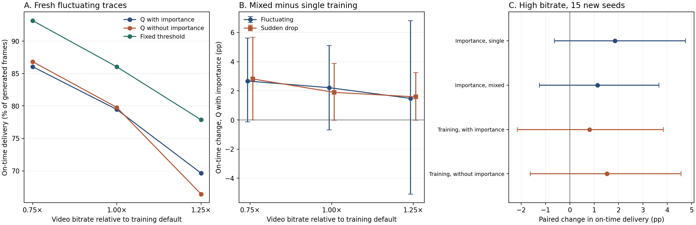

# How well does Q-learning transfer across video bitrates?

At high bitrate on fluctuating links, the original five trained agents retained an average advantage from observing head-frame importance on fresh traces. The advantage was smaller and more variable after retraining. Mixed-rate training modestly improved mean high-bitrate delivery, but results varied across training seeds. The fixed-threshold policy led both Q variants in the high-bitrate tests.



Panel A uses 120 fresh fluctuating traces and the original five training seeds. Panel B compares training methods on 100 new traces per scenario and the same five seeds. Panel C repeats the high-load comparisons with 15 new seeds and 100 additional traces. Error bars in B and C are paired 95% bootstrap intervals over both seeds and traces. Each panel uses its own test set.

## 1. Does the 3.95 percentage-point pilot gap repeat?

The outcome is the percentage of **all generated frames** delivered within 150 ms. Each row compares the same two single-rate training methods, with and without the head-frame importance input, at 1.25× bitrate on a fluctuating link.

| Evaluation | With importance | Without | Paired difference (pp) | 95% interval over traces, given these models | 95% interval over traces and training seeds |
|---|---:|---:|---:|---:|---:|
| Original 20 traces, seeds 0–4 | 71.19% | 67.24% | +3.95 | +2.64 to +5.30 | −2.19 to +12.00 |
| 120 fresh traces, seeds 0–4 | 69.66% | 66.43% | +3.23 | +2.66 to +3.81 | −2.63 to +10.33 |
| Additional 100 fresh traces, new seeds 5–19 | 70.67% | 68.81% | +1.85 | +1.64 to +2.07 | −0.64 to +4.76 |

At 0.75× and 1.0× on the 120-trace recheck, adding importance changed mean on-time delivery by −0.78 and −0.32 pp, respectively. At 1.25×, important-frame on-time delivery improved by 1.77 pp for this batch. Individual training seeds produced different policy rankings. On the 15-seed high-load check the overall differences ranged from −7.02 to +13.43 pp, including two ties. The evidence supports a positive difference for the archived model batch on fresh traces. Its magnitude remains uncertain across retraining.

## 2. Does mixed-bitrate training help?

Single-rate agents train at 1.0×. Mixed-rate agents see 200 episodes at each of 0.75×, 1.0× and 1.25×, with all other settings matched. On the initial five-seed comparison, mixed training changed the importance-aware agent's on-time rate by +2.67, +2.22 and +1.48 pp on fluctuating links at low, default and high bitrate. On sudden-drop links the corresponding changes were +2.82, +1.89 and +1.58 pp. Stable links reached 100% across conditions. After observing substantial seed variation, we ran a separate follow-up with 15 new seeds on fluctuating links at default and high bitrate.

| Policy, 15 new seeds where applicable | On time at 1.0× | On time at 1.25× | Important frames on time at 1.25× | Loss at 1.25× | Mean trace P95 delay at 1.25× |
|---|---:|---:|---:|---:|---:|
| Single, with importance | 80.91% | 70.67% | 78.38% | 21.89% | 179.4 ms |
| Mixed, with importance | 80.64% | 71.47% | 79.33% | 22.02% | 172.6 ms |
| Single, without importance | 80.13% | 68.81% | 77.39% | 22.09% | 187.2 ms |
| Mixed, without importance | 80.09% | 70.34% | 78.65% | 22.08% | 183.6 ms |
| Fixed threshold | 86.34% | 78.27% | 87.50% | 20.89% | 143.4 ms |

At high load, the paired mixed-minus-single difference was +0.80 pp with importance (joint 95% interval −2.16 to +3.84) and +1.52 pp without (−1.63 to +4.57). At the default bitrate it was −0.27 pp with importance (−1.77 to +1.17). Equivalence at the default bitrate has not been established. The fixed threshold led the best mean Q result by 6.80 pp at high load. FIFO and both adaptive Gecko baselines are in the full summary.

## Interpretation and follow-up

Keep the fixed threshold as the primary comparator. It triggers on predicted completion time, which uses remaining queued bits and instantaneous bandwidth. Q-learning currently observes coarse occupancy, head age and bandwidth bins. A targeted next experiment would add a state feature indicating whether predicted completion exceeds the deadline, then compare the original and augmented agents with a separate validation set and fresh final test traces. The [completed deadline-flag experiment](tail_deadline/README.md) tests this adjustment on fresh traces and reports its remaining gap to the fixed threshold.

## Design and uncertainty

- All runs use the simulator, rewards, flush logic and hyperparameters in the original RLv2 notebook at commit b79fb68. The frame arrival rate stays at 30 FPS. We scale frame sizes and round to whole bits. Within each condition, all policies see identical frame sizes, importance labels and bandwidth.
- Each model trains for 600 episodes. Matched training runs use the same scenario order, environment seeds and exploration seed. A separate random stream selects a balanced mixed-rate schedule. Within each scenario every bitrate gets 66 or 67 episodes. Ten single-rate retrainings for seeds 0–4 match the ten archived Q-tables element for element.
- Pilot, recheck, training comparison and follow-up use NumPy SeedSequence namespaces 2, 3, 4 and 6. Training traffic uses namespace 1 and the mixed schedule uses 5. Trace IDs pair conditions within each test set. Each trace contains 300 frames. In the sudden-drop simulator the drop schedule is deterministic, so independent draws vary frame sizes. Only the fluctuating scenario randomizes the bandwidth sequence.
- Means are averaged across traces and then training seeds. Each trace has the same frame and important-frame counts. Delay is the average of per-trace 95th percentiles over delivered frames, an aggregation that differs from the pooled P95 in the root notebook. Deterministic baselines are evaluated once per trace.
- For each contrast, subtract outcomes on matching trace and seed IDs. The trace-only interval resamples traces after averaging over the fitted seeds. The joint interval independently resamples both matched training seed IDs and matched trace IDs. Both use 10,000 bootstrap draws and percentile endpoints. The joint interval is approximate, especially with five seeds. The high-load on-time contrast is the main comparison. Other metrics and conditions are descriptive, with no correction for multiple comparisons. Traffic is synthetic.

## Reproduce and inspect

From the repository root, install NumPy and Matplotlib in a Python 3.10+ environment and run:

```sh
python -m pip install numpy matplotlib
python experiments/bitrate/run.py --workers 8
```

Tested with NumPy 2.4.4 and Matplotlib 3.10.8. The runner loads the simulator from the pinned notebook, retrains both agents in each condition and rebuilds the published results. To regenerate summaries and the figure from the saved raw observations, run `python experiments/bitrate/analyze.py`.

- [Summary metrics](results/summary.csv) for each policy and condition
- [Paired differences and both intervals](results/contrasts.csv)
- [Differences for each training seed](results/seed_differences.csv)
- [Compressed per-trace outcomes](results/paired_traces.csv.gz), one row per policy, seed, scenario, rate and trace. Deterministic policies have seed −1. Percent columns use units of 0–100.
