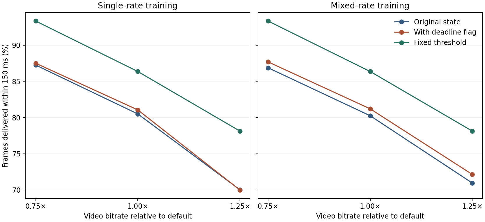

# Does predicting a tail-frame deadline miss improve Q-learning?

This experiment gives the importance-aware Q-learning agent one additional yes/no observation and measures how much of its on-time delivery gap to the fixed-threshold policy remains. The primary condition is a fluctuating wireless link at 1.25× video bitrate under mixed-rate training. Single-rate training and the eight other scenario/bitrate combinations provide matched comparisons.

## Final results

At high bitrate on the new fluctuating traces, the flag raised mixed-rate Q-learning's mean on-time delivery from **70.96% to 72.15%**. The fixed threshold achieved **78.13%** on those same traces. Its lead fell from **7.17 to 5.99 percentage points**. The paired gain was **1.19 pp** (95% interval **−0.89 to +3.33 pp**), so the direction of the gain across seeds and traces remains uncertain. The residual gap to the fixed threshold had a 95% interval of **4.41 to 7.45 pp**.

| Policy at 1.25×, fluctuating link | All frames on time | Important frames on time | Frame loss | Mean trace P95 delay |
|---|---:|---:|---:|---:|
| Single-rate, original | 70.03% | 77.00% | 22.02% | 184.6 ms |
| Single-rate, deadline flag | 70.00% | 76.71% | 21.89% | 182.6 ms |
| Mixed-rate, original | 70.96% | 77.94% | 22.12% | 176.1 ms |
| Mixed-rate, deadline flag | 72.15% | 79.34% | 21.90% | 176.0 ms |
| Fixed threshold | 78.13% | 87.00% | 21.00% | 144.1 ms |

The single-rate change in all-frame on-time delivery was −0.04 pp (95% interval −2.42 to +2.10). In the high-bitrate sudden-drop condition, the mixed-rate gain was +0.61 pp (−0.47 to +1.72). All policies reached 100% on the stable links tested. These results support retaining the adjusted agent as a documented experimental variant and the fixed threshold as the primary benchmark. The experiment covers synthetic traces and a fixed 600-episode training budget.



## What the agent observes

At a decision, the simulator has admitted the arriving frame if there is room. It knows how long the last queued frame has waited, the remaining bits of all queued frames (including a partially sent head), and the current link rate. Assuming this rate holds until the tail finishes, it calculates:

```text
predicted tail delay = current age of tail + remaining bits in queue / current bits per second
tail_deadline_flag   = 1 if predicted tail delay > 0.150 seconds, else 0
```

For example, 300,000 queued bits at 2 Mb/s take 150 ms to send. A just-arrived tail gives flag 0 at exactly 150 ms. If the tail has already waited 20 ms, the prediction is 170 ms and the flag is 1. The observation uses information available at the decision. The fixed threshold acts directly on the same predicate. The adjusted agent appends it to the original state and learns its own keep/flush action from rewards. No baseline actions are used as training targets.

The original state has 54 possible combinations (queue occupancy, bandwidth, head age and head importance). The adjusted state has 108. Both Q-tables have two action values per state.

## Matched experiment

- Training uses the same 15 seeds (5–19) as the previous confirmation. For each seed we trained four agents: original and adjusted states, each with single-rate and mixed-rate training. All 60 models received 600 episodes. Mixed training uses the same balanced 200/200/200 schedule at 0.75×/1×/1.25× as the previous experiment. Each paired run shares its training trace sequence and exploration seed.
- The simulator, reward weights, selective flush rule, learning rate, discount, exploration schedule, 12-frame capacity, 30 FPS workload and 150 ms playback deadline match the original experiment. The original-state controls matched the earlier run's four reported metrics on a reference high-load trace for all 30 seed/training combinations.
- The final test uses a new random stream (NumPy SeedSequence namespace 7), with 120 trace IDs and 300 frames per trace in each of three scenarios. All policies and bitrate multipliers use matched trace IDs. The fluctuating scenario draws new random bandwidth sequences. Stable and sudden-drop scenarios retain their specified bandwidth profiles and draw new frame sizes. The final test data were held out from training.
- The primary outcome counts on-time deliveries among all generated frames, including dropped frames in the denominator. The signed gap is fixed-threshold on-time percentage minus Q-learning on-time percentage. A positive gap reduction means the adjusted Q agent gained on the baseline. Paired 95% percentile bootstrap intervals resample training seeds and trace IDs independently (10,000 draws), preserving all policy pairings. Other scenarios, bitrates and metrics are descriptive. P95 delay is averaged over trace-level P95s for delivered frames.

## Run or reuse the final models

From the repository root with NumPy and Matplotlib installed:

```sh
python experiments/bitrate/tail_deadline.py --workers 8
```

To rebuild the aggregate results and figure from the uploaded per-trace results, use `--summarize-only`. All 60 Q-tables are included, so retraining is optional. From Python with `experiments/bitrate` as the current directory:

```python
import numpy as np
from tail_deadline import OUTPUT, load_sim, observation

sim = load_sim()
env = sim.WirelessQueue(sim.make_trace("Fluctuating", seed=123))
with np.load(OUTPUT / "q_tables.npz", allow_pickle=False) as tables:
    q = tables["mixed_tail_seed_5"]
action = int(np.argmax(q[observation(env, env.state(), tail=True)]))
```

The example selects one training seed to demonstrate inference. The reported results use all 15.

[Per-policy metrics](metrics.csv) · [Gap estimates and intervals](gaps.csv) · [Per-seed differences](by_seed.csv) · [Paired per-trace outcomes](per_trace.csv.gz) · [Trained tables](q_tables.npz) · [Experiment code](../tail_deadline.py)
